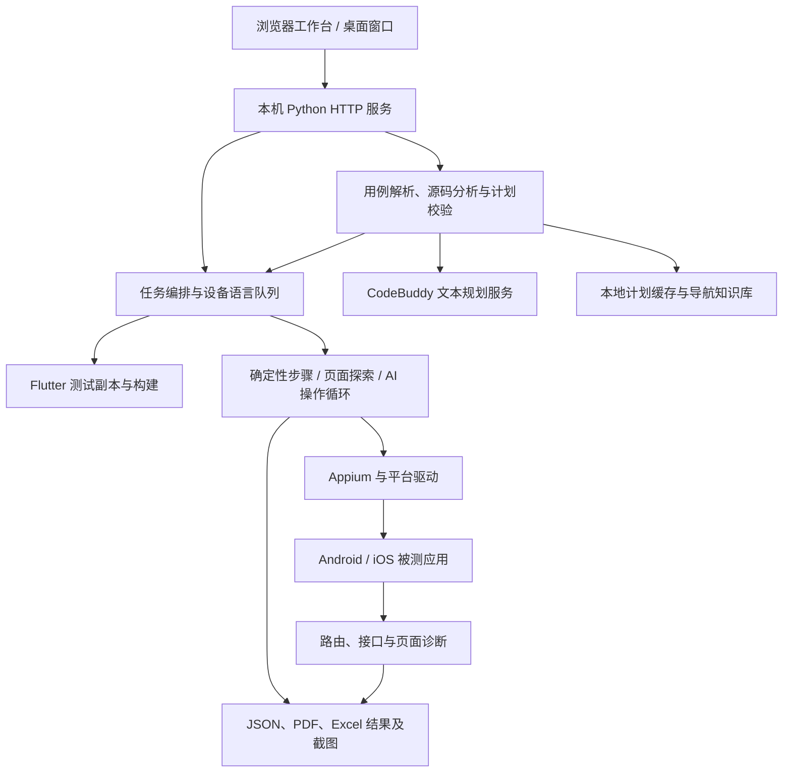

# 巡测（DeviceCheck）移动应用自动化测试技术方案

编写日期：2026 年 11 月 9 日  
适用范围：当前项目源码所实现的本地测试工作台、桌面客户端及相关执行模块。

本文基于项目代码和现有说明整理。功能描述以当前实现为依据；“设计原因”是结合实现作出的技术分析，不代表项目已完成全部实机验收。后续演进建议单独列出，不作为现有能力。

## 一、项目定位与建设目标

巡测是一个运行在测试人员本机的移动应用自动化测试工作台，主要面向 Flutter 应用及其内嵌 H5 页面，统一管理应用构建、设备选择、测试用例、自动执行、多语言组合和测试报告。

传统移动端测试通常需要分别使用构建工具、模拟器、Appium、Excel 和日志工具。测试人员既要理解业务，又要维护定位脚本；设备和语言数量增加后，还会重复执行相似操作。本项目将这些环节串成一条可配置、可追踪的本地执行流程。

建设目标包括：

1. 降低使用门槛：支持中文步骤、Excel 用例和一句话目标，减少手写自动化脚本。
2. 提高回归效率：支持设备与语言组合、构建复用、计划缓存和导航知识复用。
3. 保留验证依据：把步骤、断言、接口事件、截图和异常关联到具体任务。
4. 控制 AI 的不确定性：由模型提供建议，由本地执行器校验和操作，明确区分执行完成与业务通过。
5. 便于本地部署：提供浏览器工作台和桌面窗口，复用已有开发环境，不要求先建设中心化测试平台。

## 二、总体架构

系统采用“本地界面 + Python 服务 + 测试编排 + 平台驱动”的分层架构，AI 服务作为可选规划能力接入。

### 2.1 模块划分

| 层次 | 主要模块 | 职责 |
| --- | --- | --- |
| 交互层 | `index.html`、`desktop_main.py` | 配置任务、展示进度、预览计划、下载报告 |
| 服务与编排层 | `app.py`、`language_pipeline.py`、`cancellation.py` | 接口处理、任务生命周期、队列、取消与资源清理 |
| 规划层 | `case_workbook.py`、`flow_planner.py`、`excel_ai.py`、`codebuddy_bridge.py` | Excel 解析、源码关联、AI 规划及计划校验 |
| 执行层 | `automation.py`、`case_runner.py`、`semantic_steps.py`、`ai_operator.py` | 页面探索、用例执行、中文步骤与实时 AI 操作 |
| 平台与业务适配层 | `matrix.py`、`hybrid_webview.py`、`login_flow.py`、`language_tests.py` | 模拟器配置、原生/H5 切换、登录与语言切换 |
| 观测层 | `source_navigation.py`、`http_probe.py`、`web_diagnostics_source.py`、`page_diagnostics.py` | 路由覆盖、接口结果、加载与页面异常线索 |
| 数据与安全层 | `excel_plan_cache.py`、`action_knowledge.py`、凭据存储模块、隐私处理模块 | 缓存、SQLite 知识库、凭据管理和脱敏 |
| 交付层 | `pdf_report.py`、`desktop/` | 报告生成、客户端打包与安装 |

### 2.2 为什么采用本地分层架构

设备驱动、SDK、模拟器、Flutter 源码和测试安装包都依赖本机环境，因此本地服务能直接衔接这些工具，减少远程设备连接与文件上传的复杂度。界面与执行逻辑分开后，同一套后端可以同时服务浏览器和桌面客户端。

Python 标准库 HTTP 服务适合当前单机工具的部署方式；后台线程负责耗时任务，界面通过进度查询获取状态。它降低了运行依赖，但也意味着当前形态更适合个人或小范围测试工作台，尚不是具备多租户、分布式调度和高可用能力的平台。

## 三、核心功能与设计原因

### 3.1 运行环境检测与设备管理

**功能说明：** 检测 Android 设备、AVD、iOS 模拟器和自动化环境，提供 Appium 服务状态与环境诊断。Android 使用 UiAutomator2，iOS 使用 XCUITest；鸿蒙当前只提供环境检测。

**设计原因：** 自动化失败可能来自驱动、镜像、SDK 或应用本身。先检查环境，可以把“无法建立测试环境”和“业务断言失败”分开，避免把工具问题计入产品缺陷。复用 Appium 则能统一常见点击、输入、滑动、返回和截图操作，减少重复建设平台驱动。

### 3.2 应用来源与 Flutter 构建

**功能说明：** 支持 Flutter 源码、安装包或已安装应用标识。源码模式可以选择启动入口，并在独立测试副本中加入登录、路由和接口等观测能力，再生成测试包。构建日志随任务保存，符合条件时复用本轮构建产物。

**设计原因：** 源码模式能提供更可靠的业务证据，安装包模式便于快速接入，两种方式满足不同测试条件。使用测试副本可以隔离观测改动，避免修改原业务工程；显式记录入口和源码指纹，则能避免把不同环境、不同代码版本的包混用。

**边界：** 当前自动构建以调试包为主；特殊 flavor、复杂构建参数等仍可能需要手动构建。调试包验证不能直接替代 release 包验收。

### 3.3 设备与机型参数批量测试

**功能说明：** 支持多设备队列和 Android 参考机型配置。按分辨率、逻辑 DPI 与系统镜像创建临时 AVD，启动后校验实际参数；单项失败后继续处理后续目标。iOS 使用本机可用的 Simulator 配置。

**设计原因：** 把设备差异转换为显式测试参数，有利于批量检查不同屏幕和系统环境。严格模式不自动替换缺失镜像，是为了保留“计划测试环境”与“实际执行环境”的一致性。独立临时设备减少组合之间的状态干扰，按资源归属清理则避免关闭用户原有设备。

**边界：** 通用 Android 模拟器主要近似屏幕和系统参数，不能还原厂商 ROM、芯片性能或后台策略，因此结果属于参数组合测试，不是真机兼容性认证。

### 3.4 自动登录与凭据管理

**功能说明：** 提供当前业务 App 的内置中国区登录流程，以及通过页面标识确认成功的自定义流程。内置流程处理账号输入、密码模式切换、协议和登录，并通过测试副本中的本次成功回调事件确认登录结果。凭据可由本机凭据库管理。

**设计原因：** 登录是大部分业务用例的公共前置条件，集中实现能减少重复步骤。账号输入后回读确认、密码模式识别和成功事件校验，可以降低输入错位、异步状态变化与误判登录成功的概率。使用本机凭据引用，能避免在步骤计划中直接保存密码。

**边界：** 内置流程具有业务针对性，并非任意 App 的通用登录机器人。验证码、二次认证和未知登录页面仍可能需要人工处理；安装包模式无法直接获得源码注入的成功事件。

### 3.5 多种测试入口，共用执行能力

| 入口 | 功能 | 适用场景 | 设计原因 |
| --- | --- | --- | --- |
| 自定义 JSON | 明确配置操作、定位和断言 | 稳定回归、精确接口验证 | 保留可控、可复现的执行方式 |
| 中文业务步骤 | 将支持的固定句式转换成原生或 H5 操作 | 业务人员编写常见流程 | 降低脚本门槛，并在启动前指出无法识别的句子 |
| Excel 用例 | 读取、筛选、转换、逐条执行并回填结果副本 | 沿用现有测试资产 | 保留原行映射，便于追踪测试结果 |
| AI 大纲规划 | 生成业务用例，再匹配自动化步骤 | 从业务目标整理测试计划 | 将业务完整性与执行能力分别表达 |
| 自动页面探索 | 根据控件树尝试点击、滚动、返回并记录页面关系 | 冒烟、覆盖摸底、异常发现 | 减少预先编写脚本的工作量 |
| AI 自主操作 | 根据实时页面和目标逐轮选择受限动作 | 动态页面与临时检查目标 | 在页面变化较大时提供灵活导航能力 |

这些入口服务于不同任务，不应采用相同的通过判据。探索结束说明可达路径探索告一段落；用例通过需要对应断言成立；AI 声明完成仍保留为待复核结果。

### 3.6 Excel 用例解析与结果回填

**功能说明：** 导入本机 XLSX，按工作表、等级等条件筛选用例，将步骤转换为执行计划。执行时保存步骤证据，结束后生成保留原行号映射的结果工作簿副本。复杂或信息不足的用例记录为待转换、受阻等状态。

**设计原因：** Excel 是已有测试流程中常见的用例载体，直接接入能减少迁移成本。原行映射让测试人员能回到原始需求；转换失败与产品失败分开，则能避免“自动化尚未支持”被误解为“产品功能有问题”。

### 3.7 源码辅助分析

**功能说明：** 从 Flutter 路由、导航调用、控件文案、翻译资源、控制器和仓库中提取页面与业务线索；H5 分析关联页面及导入的接口文件。结果用于入口候选、流程草稿和 AI 规划上下文。

**设计原因：** 仅凭自然语言容易遗漏前置页面或猜错接口。源码可以补充实际入口、字段和成功码，减少模型猜测；多语言资源还可以把中文业务名称映射到当前语言文字。

**边界：** 静态关联仍是候选证据，正则与受限源码扫描不能完整理解所有动态逻辑。代码中存在某个路由，不等于当前账号在设备上可进入该页面；候选必须经过运行验证。

### 3.8 AI 业务规划与自动化匹配

**功能说明：** CodeBuddy 先生成完整业务步骤和预期，再按需将步骤匹配到执行器。两阶段可以独立触发；自动化适配失败时仍保留业务计划。执行前对动作、参数、断言和完整性再次校验。

**设计原因：** 业务用例回答“需要验证什么”，自动化适配回答“当前工具怎样执行”。分开处理能避免为了适应执行器而删除业务要求，也便于测试人员先评审业务覆盖，再补充数据和定位。

模型通过受限文本请求工作，禁用 CLI 工具与 MCP，不直接读取本地工程或执行命令。可选源码摘要由工具提前提取。这样将模型权限限制在规划范围，实际设备操作仍受本地规则控制。

### 3.9 实时 AI 自主操作

**功能说明：** 每轮读取原生控件与可用的 H5 DOM，发送脱敏页面文字，接收点击、返回、滚动、存在检查或本地数据字段输入等动作建议。执行前重新确认页面与控件，页面变化时丢弃旧决策；支持次数、时长、重复操作限制及取消。

**设计原因：** 实时页面决策能适应部分动态状态，但模型可能使用已经失效的页面信息，因此必须在执行前重新定位和检查。动作白名单和本地数据引用将建议限制在可验证的能力范围内。当前不发送截图，也不让模型提供任意脚本、坐标或命令。

**边界：** 当前偏向文字与语义控件，无法依靠纯视觉识别无文字图标。高风险操作拦截依赖规则，不能完整理解任意 App 的所有语言和业务含义。AI 完成核对仍不替代确定性业务断言。

### 3.10 原生与 H5 混合执行

**功能说明：** 原生操作使用 Appium 控件树；H5 操作进入被测 App 的唯一 WebView，使用文字、CSS 或 XPath 定位，步骤结束后恢复原生上下文。提供输入回读、元素断言、返回及绑定接口的保存动作，并匹配设备 WebView 对应驱动。

**设计原因：** Flutter/原生控件树与 H5 DOM 属于两套定位体系，统一依赖坐标难以适应分辨率和布局变化。显式切换上下文能分别使用合适的定位方式；无法恢复原生上下文时停止，可以避免后续动作落到错误页面。

**边界：** 需要 WebView 可调试且驱动匹配。填写 H5 源码目录只能增加规划证据，不能自动解决设备上的 DOM 可访问性问题。

### 3.11 表单操作与接口结果验证

**功能说明：** 支持字段填写、选择、回读和状态断言。保存、提交等动作要求绑定具体接口，验证操作后出现的请求、HTTP 状态、业务成功码及指定返回字段；H5 保存结果不确定时停止，不自动重复提交。

**设计原因：** 点击按钮成功不代表数据已保存，HTTP 200 也不一定代表业务成功。把 UI 操作和实际接口结果关联起来，可以提高结论可靠性；限制为操作之后的新事件，可减少把旧请求误当成本次结果。避免重复提交则能防止因超时重试产生重复业务数据。

**边界：** 接口验证范围取决于已安装的观察器和绑定规则，不等于采集了所有网络流量。特定报修、设备任务和 APN 等流程仍需要独立适配；当前业务成功码不能直接套用到其他系统。

### 3.12 多语言测试与接力生成

**功能说明：** 将设备与语言展开为组合，通过 App UI 点击语言选项，再执行对应测试。Excel 语言工作表可依次生成计划；设备执行当前语言时，后台继续准备下一语言，设备测试仍按队列串行运行。

**设计原因：** App 语言与系统语言可能不同，因此需要通过应用内路径切换。组合单独出报告便于定位哪种语言、哪台设备出现问题；规划和设备执行交叠可以减少等待，而串行驱动减少设备资源冲突。

**边界：** 当前切换状态主要证明语言选项已被点击，不单独证明所有文案已经切换正确。翻译键外露、未替换变量和乱码检查属于疑点提示，翻译准确性与排版质量仍需复核。

### 3.13 提速机制：本地规则、缓存和操作知识库

系统分别优化“生成步骤”和“执行导航”两个环节。

| 机制 | 实现方式 | 设计原因 |
| --- | --- | --- |
| 本地严格转换 | 常见步骤先用固定语法适配 | 简单且明确的动作无需重复调用模型 |
| 完整计划缓存 | 按用例、预期、语言、源码与验收条件复用候选 | 节省生成时间，同时避免旧计划跨版本误用 |
| 生成增量保存 | AI 小批结果校验后立即落盘 | 中断后保留已完成部分 |
| 受阻原因缓存 | 缺数据、未支持控件等明确受阻项缓存 30 天 | 避免反复请求同样无法适配的用例 |
| 语言内去重与受限跨语言复用 | 保留原行执行，翻译键唯一时复用部分原生步骤 | 减少重复规划，并保留每条用例的结果 |
| 本地导航知识库 | SQLite 保存版本范围、页面指纹和脱敏动作关系 | 将已确认导航转为可复用经验 |
| 导航意图归一化 | 识别有限的同义动词与起终点顺序 | 避免仅因表达变化而重复生成 |

缓存保存的是候选操作，不保存“业务已经通过”的结论。源码变化会使对应计划范围失效；导航重放时仍在当前页面唯一匹配控件，结果页面不符就停用规则。输入、提交、删除、支付等动作不自动学习重放。

这种设计以版本和页面证据约束复用，比保存旧坐标更能适应设备差异。代价是全量源码指纹较保守，部分无关代码变化也可能降低缓存命中率。

### 3.14 页面诊断、覆盖记录与报告

**功能说明：** 记录页面状态、路由、操作路径、未覆盖项、接口异常、加载观测及页面疑点。H5 可采集 XHR/fetch、JavaScript 错误和 DOM 几何异常；原生接口与路由信息依赖对应源码观察器。任务输出 JSON、PDF、截图及适用时的 Excel 结果。

**设计原因：** 单一 pass/fail 难以解释问题。结构化报告便于继续处理，PDF 便于评审与归档，截图帮助定位实际页面。将覆盖、断言与异常分开记录，可以让使用者知道“走到了哪里”和“证明了什么”。异常优先截图、页面去重与图片压缩则用于控制报告体积。

**边界：** 空白、裁切、横向溢出等属于规则检测线索，不是完整视觉验收。操作到内容出现的观测时间、路由到首帧时间与接口耗时含义不同，不能统一解读为精确的用户性能指标。

### 3.15 取消、清理与任务恢复

**功能说明：** 停止操作覆盖排队、构建、设备启动等待及测试执行，保留已有结果，并清理工具创建的临时资源。语言接力状态落盘，页面刷新可以重新查看；部分生成任务可在同一服务进程中重新连接。

**设计原因：** 停止测试不仅是修改界面状态，还需要终止后续动作、回收模拟器与会话。将取消控制传递到各阶段，可以减少停止后继续执行的问题；资源归属判断则避免清理用户原先启动的模拟器和其他服务。

**边界：** 已发送到设备的单条命令可能仍需等待结束；服务关闭后并非所有任务都能从断点继续。持久化的候选计划和进度记录，不等于底层请求或设备会话可以续传。

### 3.16 桌面交付与隐私处理

**功能说明：** 桌面版通过 pywebview 复用本地工作台，以 PyInstaller 打包，并提供 Mac、Windows 构建配置。桌面版使用独立的后端和 Appium 端口，运行数据放入用户可写目录。AI 密钥和测试凭据通过相应本机存储模块管理；日志、XML、接口参数和对外页面文字执行脱敏处理。

**设计原因：** 复用页面与后端可以避免维护两套产品；数据与安装目录分离便于安装、升级和权限管理。凭据与计划、报告分离，既支持自动执行，也降低泄露风险。接口诊断使用字段白名单而非完整请求体，保留排障必要信息。

**边界：** 本地截图仍可能包含登录后的业务数据。报告、SDK、凭据和测试源码副本不应打入分发包。当前 Windows 构建与实机行为、客户端签名公证及桌面包完整业务回归仍需补充验证。

## 四、端到端执行流程

1. **配置与预检：** 选择应用、入口、设备、语言和测试方式，校验环境及必要数据。
2. **计划准备：** 解析 JSON、中文步骤、Excel 或 AI 大纲；查找可复用计划，补充源码证据，并校验动作与断言。
3. **构建与环境准备：** 创建必要的测试副本，编译或校验安装包，启动目标设备并建立 Appium 会话。
4. **公共前置：** 按配置执行登录、语言切换和页面恢复，确认可继续的状态。
5. **测试执行：** 执行明确步骤、探索或 AI 操作；每步定位、检查、记录，必要时读取接口结果。
6. **诊断与证据：** 汇总路由、接口、加载和页面异常，按截图策略保留证据。
7. **结果输出：** 生成任务报告及适用的 Excel 回填，明确失败、受阻、待转换和待复核原因。
8. **资源释放：** 结束会话，清理临时设备和源码副本，继续下一个组合或结束批次。

普通新批次在预检与上一批清理结束后会清理旧报告，接力模式会保留本轮前序组合。需要长期留存的结果应提前导出；报告目录不是长期审计档案库。

## 五、结果判定原则

| 观察到的结果 | 能支持的结论 | 不能据此推导的结论 |
| --- | --- | --- |
| 点击执行成功 | 驱动完成了目标操作 | 后台业务已成功 |
| 页面文字存在 | 当前或记录时页面出现了该文字 | 完整流程与数据均正确 |
| 接口及业务字段断言成立 | 绑定范围内的本次业务结果符合预期 | 所有后端链路都无异常 |
| 探索结束 | 当前策略下的探索已结束 | 所有页面均已覆盖 |
| AI 声明完成并核对 | AI 辅助判断目标可能完成，需复核 | 确定性业务验收通过 |
| 页面疑点被记录 | 发现需要检查的现象 | 已确认视觉或性能缺陷 |
| 计划或知识命中 | 找到可重新验证的候选操作 | 可以跳过本次测试 |

这套判定方式是项目的重要设计取舍：用证据范围约束结论，减少自动化误报成功。

## 六、当前适用范围与实现取舍

项目更适合已有本机开发环境、以 Android/iOS 回归为主、需要复用 Excel 用例，并愿意为关键流程补充明确断言的团队。纯安装包也可接入，但源码模式可提供更强的登录、路由和接口观测。

当前实现包含针对 Keenon 业务应用的登录、首页/消息/我的导航、语言及报修等适配。通用驱动能力与这些业务规则共同构成现有产品能力，接入其他 App 时，需要重新确认入口、定位、成功码和业务数据，不能直接视为零配置支持。

主要取舍包括：

- **本地部署优先：** 降低基础设施成本，同时依赖每台工作机的环境一致性。
- **设备串行执行：** 降低驱动与资源冲突，同时限制大规模吞吐量。
- **确定性规则优先、AI 补充：** 提高可控性，同时需要维护规则和业务适配。
- **证据约束复用：** 降低旧计划误用风险，同时可能牺牲缓存命中率。
- **不确定时明确受阻：** 保留可信结果，同时需要测试人员补数据或处理特殊页面。

## 七、后续演进建议（尚非现有能力）

| 优先级 | 建议 | 目的与验收方向 |
| --- | --- | --- |
| P0 | 建立关键业务实机回归基线 | 按平台、角色和语言验证登录、导航、表单与接口断言，保存可复现证据 |
| P0 | 抽离业务 App 适配配置 | 将通用执行器与登录、导航、成功码规则分离，以第二个 App 验证复用边界 |
| P1 | 完善环境锁定与健康检查 | 固定经过验证的驱动组合，缩短新机器安装和故障定位时间 |
| P1 | 完善报告留存与导出策略 | 支持按批次、版本长期保存结果，避免仅保留当前批次造成证据缺失 |
| P1 | 提供缓存失效解释 | 明确展示源码、语言、预期或数据变化造成的未命中，便于排查生成耗时 |
| P1 | 完成桌面交付验证 | 在目标系统完成构建、签名及设备回归，形成可分发安装包 |
| P2 | 增加视觉基准和真机验证 | 在现有疑点检测之外，补充截图差异与真实厂商设备覆盖 |
| P2 | 按规模需求演进调度 | 若需要团队协作，再建设多用户权限、设备池和分布式队列 |

## 八、方案依据与验证口径

本方案主要依据 `README.md`、`desktop/README.md`，以及服务编排、用例规划、执行器、缓存、导航知识库、WebView 和页面诊断模块整理。设计原因属于对当前实现的技术解释，后续建议属于建议项。

本次交付为技术说明文档，未启动设备、调用 AI 服务或执行真实业务。项目已有测试文件和历史验证记录，可作为后续验收线索，但不能据此认定当前全部功能已在真实 App、所有语言与两种桌面系统上完成端到端验证。
